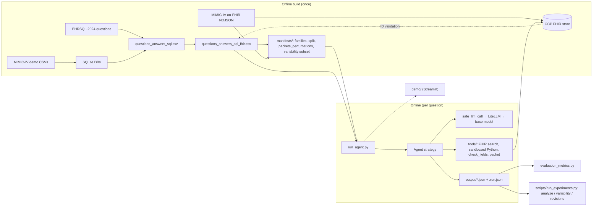
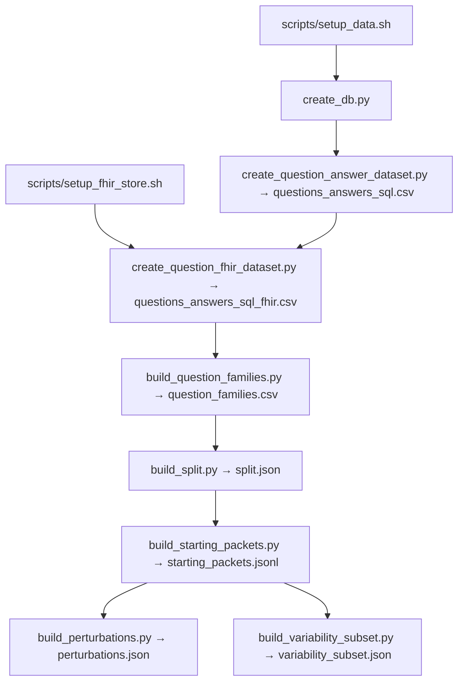
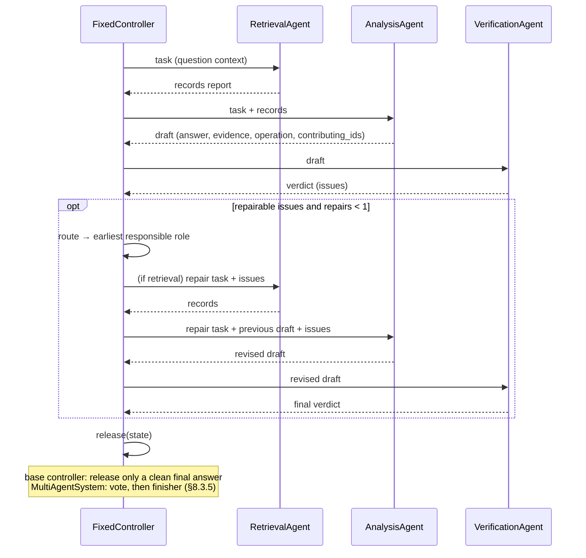

# Architecture walkthrough

This document explains how the whole system fits together, from raw MIMIC-IV
data to experiment reports. The phase notes ([Phase 1](phase1_review.md),
[Phase 2](phase2_framework.md), [Phase 3](phase3_experiments.md)) record why
each piece was built and what was reviewed. This document describes how the
pieces connect and where to find them in the code.

References use `path:line` and point at the definition. Line numbers are
accurate as of the commit below. They will drift, so search for the named
symbol if a line has moved.

> **Current as of `5ceb466`** (branch `feat/multi-agent-v2`, PR #79). The
> multi-agent system is now **v2**:
>
> - retrieval loads complete records;
> - analysis gets the full context;
> - the answer is released by a vote, then passed through deterministic
>   finishers.
>
> See [§8.3](#83-multi_agent-multiagentsystem-agentmulti_agentpy31). Open-weight
> models (Qwen3 on Ollama, gpt-oss on vLLM) run on the same model layer
> ([§4.6](#46-local-open-weight-models)). All three systems still share **one
> configured base model** (CC-28, `d87ae5a`).

---

## Contents

0. [Summary](#0-summary)
1. [System overview](#1-system-overview)
2. [Repository map](#2-repository-map)
3. [Data sources and the offline pipeline](#3-data-sources-and-the-offline-pipeline)
4. [Configuration and the model layer](#4-configuration-and-the-model-layer)
5. [The runner: `run_agent.py`](#5-the-runner-run_agentpy)
6. [Agent core: `BaseAgent` and the output contract](#6-agent-core-baseagent-and-the-output-contract)
7. [Tools layer](#7-tools-layer)
8. [The systems under comparison](#8-the-systems-under-comparison)
9. [End-to-end trace of one multi-agent question](#9-end-to-end-trace-of-one-multi-agent-question)
10. [Evaluation](#10-evaluation)
11. [Experiments and analysis](#11-experiments-and-analysis)
12. [Demo](#12-demo)
13. [Cross-cutting design principles](#13-cross-cutting-design-principles)
14. [Testing map](#14-testing-map)
15. [Known quirks and limitations](#15-known-quirks-and-limitations)

---

## 0. Summary

The system answers questions about **one patient's FHIR record**. For
example: "What was the last creatinine value of patient X during their first
hospital visit?" The data is the MIMIC-IV Clinical Database Demo (100
patients). It is loaded into a **Google Cloud Healthcare R4 FHIR store**.
The questions and gold answers come from **EHRSQL-2024**. Each question's SQL
is run against MIMIC, and the rows it touches are mapped to FHIR resource IDs.

Three systems are compared under the same base model and the same
per-question budget:

| System | Strategy flag | What it does |
|---|---|---|
| Direct LLM | `direct_llm` | One LLM call over a deterministic "starting packet" of the patient's record. No tools. |
| Single agent | `single_agent` | One ReAct agent with FHIR retrieval, sandboxed Python and a field checker. Its first answer is checked automatically and it may revise once. |
| Multi-agent | `multi_agent` | A fixed, non-LLM controller runs **retrieval → analysis → verification** and routes at most one repair. Retrieval loads the patient's complete records of each relevant type. The released answer is a **vote** among the team's answers, then a deterministic finisher applies benchmark conventions for seven question templates (§8.3.5). |

Six older single-turn and multi-turn agents from FHIR-AgentBench are still
runnable as baselines. They are not part of the Phase 3 comparison.

---

## 1. System overview



The system has two halves.

**Offline build.** These steps run once and produce frozen files that are
checked in or hash-pinned: the datasets in `final_dataset/` and the manifests
in `manifests/`.

**Online run.** For each question, the runner builds a prompt string, creates
an agent, applies a budget and an optional perturbation, and stores a
contract-shaped result. Everything downstream reads those result files:
evaluation, statistics, revision tracking and the demo's "evaluated run"
check.

---

## 2. Repository map

| Path | Role |
|---|---|
| `run_agent.py` | CLI runner. Handles batching, resume, run identity and result storage. |
| `agent/` | All agent strategies. `base_agent.py` holds the shared contract and budget. `framework.py` and `controller.py` hold the multi-agent machinery. There is one file per role and per baseline. `multi_agent.py` holds the v2 release vote. `finishers.py` and `template_router.py` hold the deterministic finishers, and `ehr_semantics.py` the shared conventions guide (§8.3). |
| `tools/` | Tools that register themselves (FHIR search, raw request, sandboxed Python, field check), the tool cache, the starting-packet builder and the perturbation loader. |
| `utils/` | `core_utils.py` (config, LLM transport, agent factory, I/O), `model_config.py` (the shared base model), `answer_scorer.py` (typed scorer), `evidence_scorer.py` (citation resolution), `metrics_utils.py`, `fhir_utils.py` and `sql_to_fhir_utils.py` (dataset construction). |
| `fhir_client.py` | Client for the Google Cloud Healthcare FHIR API, with pagination. |
| `evaluation_metrics.py` | Scores one result file: retrieval, evidence, typed accuracy and the LLM judge. |
| `scripts/` | Data setup, manifest builders, the Phase 3 orchestrator and its analysis modules, setup checks, per-strategy launchers and the Slurm jobs for RIS Compute2 (`run_experiments_{qwen,vllm}.sbatch`). |
| `demo/` | Streamlit demo: `app.py` (UI) and `backend.py` (logic, no Streamlit). |
| `manifests/` | Frozen, hash-pinned experiment inputs: the split, families, starting packets, perturbations and the variability subset. |
| `final_dataset/` | The question/answer/FHIR-ID datasets built offline. |
| `tests/` | `unittest` suites named `test_phase{1,2,3}_*.py`. |
| `config.example.yml` | Template for `config.yml`: model, API keys and FHIR store coordinates. |
| `config.py` | Constants used **only for dataset construction**: MIMIC paths, templates and label mappers. The agent runtime does not use it. |

---

## 3. Data sources and the offline pipeline

### 3.1 Sources

| Source | Used for | Location |
|---|---|---|
| MIMIC-IV Clinical Database Demo v2.2 (PhysioNet CSVs) | SQL ground truth | `./data/*.csv`, created by `scripts/setup_data.sh` |
| MIMIC-IV Clinical Database Demo on FHIR v2.1.0 (PhysioNet NDJSON) | The FHIR store the agents query; local NDJSON for packets and evidence checks | GCP Healthcare R4 store, created by `scripts/setup_fhir_store.sh` |
| EHRSQL-2024 (`data/mimic_iv/{train,valid,test}/annotated.json`) | Questions, SQL and templates | Cloned by `scripts/setup_data.sh` |

### 3.2 Build order



1. **`scripts/setup_data.sh`** downloads the MIMIC-IV demo, gunzips the
   `hosp/` and `icu/` tables into `./data/`, and clones `ehrsql-2024`.

2. **`scripts/setup_fhir_store.sh`** does the GCP setup:
   - takes `PROJECT_ID LOCATION DATASET_ID STORE_ID BUCKET` from the environment;
   - enables `healthcare.googleapis.com` and downloads the FHIR NDJSON;
   - uploads the NDJSON to `gs://$BUCKET/mimic-fhir/`;
   - creates the dataset and an R4 store with `--enable-update-create`;
   - runs `fhir-stores import gcs --content-structure=resource`.

   The Phase 1 import loaded 928,935 resources ([run log](phase1_run_log.md)).
   `scripts/check_setup.py` then confirms the store holds exactly 100
   Patients plus a known smoke patient.

3. **`create_db.py`** loads 16 MIMIC tables into two SQLite files:
   `data/mimic_iv_unprocessed.sqlite` (lowercased) and
   `data/mimic_iv_unprocessed_raw.sqlite` (raw case). It adds a `row_id` of the
   form `"{table}_{index}"`, and derives `charttime` for procedures and
   diagnoses.

4. **`create_question_answer_dataset.py`** builds the question/answer table.
   - It filters EHRSQL down to answerable patient-level questions. Cost,
     insurance, `d_icd_*` main tables, removed templates and questions with no
     subject are dropped.
   - It replaces EHRSQL's placeholder year `2100` with each patient's MIMIC
     `anchor_year` (`utils/fhir_utils.py`, `apply_anchor_replacements`).
   - It restores natural-case values and generates the "Assume the current
     time is …" assumption.
   - It runs the SQL to get `true_answer`.
   - Output: `final_dataset/questions_answers_sql.csv` (3,105 rows).

5. **`create_question_fhir_dataset.py`** attaches gold FHIR IDs to each question.
   - It rewrites each query to return full rows, using `replace_sql_query` in
     `utils/sql_to_fhir_utils.py`.
   - It maps each row to a FHIR ID with the MIMIC-on-FHIR UUID5 scheme:
     `uuid5(uuid5(uuid5(NAMESPACE_OID,'MIMIC-IV'), resourceType), table_id)`
     (`convert_table_id_to_fhir_id`).
   - It **validates every ID against the live store** and drops any that are
     missing.
   - Outputs:
     - `final_dataset/questions_answers_fhir.csv`: one row per gold resource.
     - `final_dataset/questions_answers_sql_fhir.csv`: 2,931 questions with
       `true_fhir_ids = {type: [ids]}`. **Every later step reads this file.**

6. **`scripts/build_question_families.py`** writes
   `manifests/question_families.csv`.
   - It classifies templates into `lookup_counting`, `temporal_selection` and
     `numerical_aggregation`.
   - Paired-difference, paired-comparison and duration templates get an
     `excluded_reason` and are treated as `out_of_scope`.

7. **`scripts/build_split.py`** writes `manifests/split.json`. It uses seed 5106
   and produces **patient-disjoint** pilot / dev / held_out splits:

   | Split | Questions | Patients |
   |---|---|---|
   | pilot | 20 | 3 |
   | dev | 50 | 32 |
   | held_out | 300 | 59 |

   The patient column is the size of each split's patient pool. The 300
   held-out questions themselves come from 58 of those 59 patients, which is
   the number that matters for the clustered bootstrap (§11.2).

   Patients already seen during development are forced into dev. These are
   listed in `manifests/development_exposure.json` (proposal examples,
   few-shot prompts, earlier runs). EHRSQL's own train/valid/test labels are
   ignored because they are not patient-disjoint.

8. **`scripts/build_starting_packets.py`** writes
   `manifests/starting_packets.jsonl` (370 rows) and
   `manifests/starting_packets.source.json`.
   - It runs the deterministic packet builder (§7.6) over the **local NDJSON**,
     not the store, for every split question.
   - It records the IDs, hashes, token counts and truncation for each packet.
   - The source file records the per-NDJSON-file SHA-256.

9. **`scripts/build_perturbations.py`** writes `manifests/perturbations.json`
   (version 2).
   - It uses an offline SQL oracle, `scripts/packet_query.py`. The oracle
     projects the fields visible in each packet into an in-memory SQLite DB.
   - A held-out question is eligible if the released SQL reproduces the
     reference **and** removing exactly one packet resource changes the
     answer.
   - 55 of the 300 held-out questions are eligible. 50 are sampled, in
     proportion to family.
   - The agents never see the oracle. See [Phase 2 §P2-18](phase2_framework.md).

10. **`scripts/build_variability_subset.py`** writes
    `manifests/variability_subset.json`. It draws 20 held-out questions,
    stratified by family (6 lookup, 3 numerical, 11 temporal), from 17
    patients.

### 3.3 The hash chain

Each manifest records the SHA-256 of the files it was built from.
`tools/perturbation.py:37` (`load_perturbations`) checks 8 of these files:

- the source CSV, split, families and packets
- the packet builder, `scripts/packet_query.py`, `tools/perturbation.py` and
  `utils/answer_scorer.py`

If any upstream file changes, the downstream loaders fail instead of silently
mixing versions. The demo applies the same rule when it loads patients
(`demo/backend.py:46`).

---

## 4. Configuration and the model layer

This section covers the shared-model change, PR #75 / CC-28 (`d87ae5a` =
`7ba863a` + `b86ea69`), and the configuration plumbing it builds on.
§4.6 covers the later support for local open-weight models.

### 4.1 `config.yml`

`config.example.yml` is the template. `config.yml` itself is git-ignored.

```yaml
# One base model for all three systems (CC-28); $MODEL overrides it, and --model overrides both
MODEL: "gpt-6-luna"
OPENAI_API_KEY: "your-api-key"
GEMINI_API_KEY: "your-api-key"
FHIR_CONFIG:
  PROJECT_ID: ...
  LOCATION: ...
  DATASET_ID: ...
  STORE_ID: ...
```

The helpers in `utils/core_utils.py` read it:

- `load_config` (`utils/core_utils.py:32`) and `setup_api_keys`
  (`utils/core_utils.py:62`). The second one exports the OpenAI and Gemini
  keys to the environment. Environment variables take precedence.
- `get_model_provider` (`utils/core_utils.py:82`) maps a model name to openai
  (`gpt-N`, `oN`), gemini, qwen or meta-llama.
- `get_fhir_config` (`utils/core_utils.py:120`) reads the `FHIR_*` environment
  variables first, then `FHIR_CONFIG`.
- `validate_config` (`utils/core_utils.py:132`) requires a key for the model's
  provider and a complete FHIR config. Qwen and Llama also require `base_url`;
  for Qwen it defaults to a local Ollama server (`get_default_base_url` in
  `utils/model_config.py`: `$BASE_URL`, then `BASE_URL` in config.yml, then
  `http://localhost:11434/v1`).

### 4.2 One shared base model (`7ba863a`)

**Why.** The study compares *architectures*. If the direct baseline, the
single agent and the multi-agent system ran on different LLMs, any difference
in results would mix architecture with model. Before CC-28, each entry point
had its own hardcoded default (`o4-mini` in most of them), and
`run_experiments.py` required `--model` on every call.

**How.** `utils/model_config.py` is now the single source of the default:

```python
DEFAULT_MODEL = "gpt-6-luna"                              # utils/model_config.py:23

def get_default_model():                                  # utils/model_config.py:50
    # 1. $MODEL   2. MODEL in config.yml   3. DEFAULT_MODEL
```

- `_configured` (`utils/model_config.py:29`) treats empty strings and
  `config.example.yml` placeholders (`your-…`) as unset, so the lookup falls
  through to the next source.
- The module imports nothing from the project, so it is fast and safe to run
  as a script. `python utils/model_config.py` prints the model, and this is
  how the shell launchers get it.
- `utils/__init__.py` re-exports `DEFAULT_MODEL` and `get_default_model`.

**Precedence.** `--model` on the command line wins over `$MODEL`, which wins
over `MODEL` in `config.yml`, which wins over `gpt-6-luna`.

**Entry points that use it:**

| Entry point | Before | Now |
|---|---|---|
| `run_agent.py` `--model` | `o4-mini` | `get_default_model()` |
| `scripts/run_experiments.py` `--model` | required | `get_default_model()`; one model for **all 22 arms** |
| `demo/app.py` `--model` | `$MODEL` or `o4-mini` | `get_default_model()` |
| `scripts/check_setup.py` `--model` | `o4-mini` | `get_default_model()` |
| `evaluation_metrics.py` (LLM judge) | `o4-mini` mapping | `get_default_model()` via `safe_llm_call` |
| `scripts/run_*.sh` (9 strategy launchers and `run_smoke_test.sh`) | `${MODEL:-o4-mini}` | `$(python utils/model_config.py)` |

The model is part of `run_identity` (§5.3). A result file produced with a
different model therefore shows as **stale** and is left out of the analysis.
This prevents mixing models after the fact.

### 4.3 The LLM transport: `safe_llm_call`

All LLM traffic goes through `safe_llm_call` (`utils/core_utils.py:431`). This
includes every agent, every role and the evaluation judge.

1. **Prompt cap.** `count_tokens_in_messages` (`utils/core_utils.py:357`)
   estimates the prompt plus tool schemas. If the estimate is above
   `max_tokens=32000`, the call returns an error and makes no request.
2. **Request.** It calls `litellm.completion` with temperature 0, with the
   per-model adjustments described in §4.4.
3. **Usage.** For each call it records prompt, completion, total and cached
   tokens, plus `cost` from `_hidden_params.response_cost`. **An unknown cost
   is stored as `None`, never as 0.** A `None` cost also makes the total `None`.
4. **Retries.** It retries up to `max_retries` times (default 5), sleeping 5 s
   between attempts. A `BadRequestError` is **not** retried. An empty or
   `None` reply triggers a retry with a nudge appended.
5. **Qwen and gpt-oss.** Qwen requests (e.g. `qwen3:32b` on Ollama) go through the OpenAI
   transport with a placeholder API key, `think: false` and
   `reasoning_effort: "none"`. gpt-oss requests use the same transport with
   `reasoning_effort: "medium"` (§4.6). For Qwen, native
   `tool_calls` are kept; `qwen_parse_tool_calls` is only a fallback for raw
   `<tool_call>` text. `<think>` blocks are stripped, and a reply that was only
   reasoning is retried as empty.

### 4.4 Luna transport and redaction (`b86ea69`)

`gpt-6-luna` is newer than the LiteLLM model registry pinned in
`requirements.txt`. Without special handling, LiteLLM would not know that
Luna is a reasoning model, and could send parameters Luna rejects. The fix has
four parts:

- **Hard-coded reasoning detection.** `is_reasoning_llm`
  (`utils/core_utils.py:528`) returns `True` for `o4-mini` and `gpt-6-luna`
  (with or without an `openai/` prefix) **before** consulting
  `litellm.supports_reasoning`. If the registry lookup fails, the function now
  returns `False` instead of guessing.
- **Luna request shape.** `_is_luna_chat_model` (`utils/core_utils.py:386`)
  marks Luna requests. For those requests, `safe_llm_call`:
  - sends `extra_body={"reasoning_effort": "none"}`. This is Luna's supported
    Chat Completions tool-calling mode, and `extra_body` keeps the setting
    even though the registry has no Luna metadata;
  - sets `custom_llm_provider="openai"`;
  - omits `temperature` and caps output with `max_completion_tokens`, because
    Luna is a reasoning model.
- **One transport for the judge.** `evaluation_metrics.call_model`
  (`evaluation_metrics.py:87`) now calls
  `safe_llm_call(model, messages, max_retries=1)`. The old `model_mapping` and
  temperature branch are gone, so the secondary judge uses exactly the same
  request shape as the agents.
- **Secret-safe config errors.** If `config.yml` is not valid YAML,
  `get_default_model` raises `"Could not read the model configuration at …"`.
  The message does not include the YAML parser's diagnostic, because that
  diagnostic can quote source lines containing API keys.

**Request parameters by model class:**

| Model class | `temperature` | Completion cap key | `extra_body` | `custom_llm_provider` |
|---|---|---|---|---|
| `gpt-6-luna` / `openai/gpt-6-luna` | omitted | `max_completion_tokens` | `{"reasoning_effort": "none"}` | `openai` |
| Other OpenAI reasoning models (`o4-mini`, registry-flagged) | omitted | `max_completion_tokens` | none | `openai` only if `base_url` is set |
| Non-reasoning and non-OpenAI models | `0.0` | `max_tokens` | none | `openai` only if `base_url` is set |

A completion cap is only sent when the agent has a token budget (§6.2). When a
cap is sent, LiteLLM's own retries are disabled (`num_retries=0`).

### 4.5 Tests for CC-28

| File | Covers |
|---|---|
| `tests/test_phase3_model_config.py` | Resolution order: env, then config, then default. Placeholders and blanks fall through. An unreadable config is an error, not a silent default. Every entry point and launcher uses the shared setting. Every experiment arm uses the same model. Reasoning vs non-reasoning request parameters. |
| `tests/test_phase3_luna_transport.py` | Sends Luna requests through **real LiteLLM and OpenAI SDK parameter mapping** over an offline transport: with and without tools, with and without a budget, the actual secondary judge, the `openai/` prefix, and independence from registry metadata or lookup failures. Also checks that non-reasoning OpenAI models keep their own parameters. |
| `tests/test_phase3_model_readiness.py` | Luna stays a reasoning model when the registry has no entry for it. A malformed-config error does not echo secret source lines. |

### 4.6 Local open-weight models

The Phase 3 results use open-weight models on WashU RIS Compute2 GPUs.
`docs/compute2-gpu.md` has the cluster recipe.

- **Endpoint.** `get_default_base_url` (`utils/model_config.py:54`) uses
  `$BASE_URL`, then `BASE_URL` in `config.yml`. For Qwen and gpt-oss models
  it then falls back to a local Ollama server (`http://localhost:11434/v1`).
  Any other model gets `None`, the provider's hosted API.
- **Provider.** `get_model_provider` maps `gpt-oss*` to its own provider.
  Like Qwen and Llama, it needs a `base_url`.
- **gpt-oss on vLLM.** `scripts/run_experiments_vllm.sbatch` serves gpt-oss
  with vLLM on port 28431, because port 8000 is often taken on shared nodes.
  Ollama is not used for gpt-oss: it answers a tool call whose arguments are
  not valid JSON with HTTP 500. `safe_llm_call` sends such a rejected call
  back to the model to correct, instead of retrying the same request.
- **Qwen on Ollama.** `scripts/run_experiments_qwen.sbatch` serves Qwen
  with Ollama. Both jobs run `scripts/run_experiments.py` with a fixed
  `base_url`, because the URL is part of the run identity (§5.3). Both jobs
  refuse to start if the Python sandbox does not work on the node.

---

## 5. The runner: `run_agent.py`

### 5.1 CLI

`build_parser` (`run_agent.py:40`) defines the CLI.

| Flag | Meaning |
|---|---|
| `--agent_strategy` | One of the 9 strategies (§8). |
| `--model`, `--base_url` | Base model (default from §4.2) and optional self-hosted endpoint. |
| `--input`, `--output`, `--limit` | Dataset (default `final_dataset/questions_answers_sql_fhir.csv`), result path and row limit. |
| `--split_manifest`, `--split` | Select pilot, dev or held_out from `manifests/split.json`. |
| `--perturbations`, `--condition {intact,omitted}` | Run on the perturbed held-out subset (§7.7). |
| `--subset`, `--repeat` | Variability subset and repeat index. |
| `--max_total_tokens`, `--max_tool_calls` | Per-question budget (§6.2). |
| `--enable_cache` | Turn the on-disk tool cache on or off (§7.5). |
| `--num_processes`, `--save_interval` | Parallelism and checkpoint frequency. |

### 5.2 Flow of `main` (`run_agent.py:342`)

1. Validate flag combinations. For example, perturbations require
   `--split held_out`.
2. `load_inputs` (`run_agent.py:98`) reads the CSV. `select_split`
   (`run_agent.py:116`) applies the split manifest and checks its source hash.
3. `run_identity` (`run_agent.py:225`) builds this run's identity (§5.3).
4. `prepare_results` (`run_agent.py:282`) loads any existing output. It
   **refuses to resume** if the saved `.run.json` identity is different.
5. `curate_input_dataset` (`utils/core_utils.py:263`) builds each prompt string:

   ```
   Question: <question>
   Context:
   Patient FHIR ID is <uuid>.
   <assumption, e.g. "Assume the current time is 2137-05-04 12:00:00.">
   ```

   `parse_question_context` (`utils/core_utils.py:281`) reverses this format.
   Agents use it to recover `(question, patient_fhir_id, current_time)`.
6. `is_done` (`run_agent.py:184`) skips rows that already have a result.
   `validate_config` and `check_tool_credentials` fail fast on bad
   credentials.
7. The remaining rows run through `multiprocessing.Pool.imap` over
   `run_agent_with_input` (`utils/core_utils.py:341`). For each row it:
   - sets `tools.cache.CACHE_ENABLED`;
   - creates the agent with `create_agent` (`utils/core_utils.py:299`, the
     strategy → class registry);
   - calls `set_budget` and `set_perturbation`;
   - makes **one** attempt through `run_agent_safe` (`utils/core_utils.py:323`);
   - converts the output with `parse_outputs` (`utils/core_utils.py:222`) into
     `RESULT_COLUMNS` (`utils/core_utils.py:218`).
8. `store_attempt` (`run_agent.py:306`) writes the result into the row. A
   previous failed attempt is kept in `attempt_history`, so retry costs stay
   visible.
9. Results are written atomically by `_write_json` (`run_agent.py:251`) every
   `--save_interval` rows and at the end. `print_usage_summary`
   (`run_agent.py:321`) reports tokens, cost and latency.

Default output path: `output/{agent_strategy}_{model}_results.json`, plus
`….json.run.json`.

### 5.3 Run identity and resume

`run_identity` records:

- the strategy, model, a hash of `base_url`, and the budget;
- `add_patient_fhir_id` and `enable_cache`;
- a hash of the input rows, plus hashes of the split manifest, perturbation
  manifest and variability subset;
- the split, condition and repeat;
- a **code fingerprint** from `code_fingerprint` (`run_agent.py:144`). This is
  a hash of every source file in `agent/`, `tools/` and `utils/`, plus runtime
  dependency versions from `runtime_dependency_versions` (`run_agent.py:159`).

The effect is that changing code, a manifest, the model or the budget makes
existing result files **stale**. They cannot be resumed into, and the
orchestrator excludes them from analysis.

---

## 6. Agent core: `BaseAgent` and the output contract

### 6.1 `BaseAgent` (`agent/base_agent.py:16`)

Every strategy subclasses `BaseAgent` and implements `_run(question)`.
`BaseAgent` provides:

- **`set_budget(max_total_tokens, max_tool_calls)`** (`agent/base_agent.py:58`):
  per-question ceilings. `None` means unlimited.
- **`set_perturbation(spec)`** (`agent/base_agent.py:66`): the frozen omission
  spec for recovery runs.
- **`_llm_call(messages, tools)`** (`agent/base_agent.py:107`): the only way
  agents call the LLM. It enforces the budget (§6.2) and accumulates usage.
- **`_take_tool_call()`** (`agent/base_agent.py:138`) and
  **`_tool_budget_message`** (`agent/base_agent.py:146`): tool-call accounting,
  and the reply sent once the tool budget is used up.
- **`run(question)`** (`agent/base_agent.py:152`): times `_run`, normalizes
  its output into the contract (§6.3), and validates it.
  - It also accepts the legacy `{"final_answer", …}` shape. Free text in that
    shape goes through `parse_final_message`.
  - A budget stop becomes an **abstention with a limitation**, not an error.
  - Any other error clears `answer` and `evidence`.
  - A contract violation replaces the answer with an "invalid output contract"
    error.

### 6.2 Budgets

**Token ceiling.** Before each call, `_llm_call`:

1. estimates the prompt and reserves `prompt + max(64, 5% of prompt)`;
2. sets `remaining` to the ceiling minus tokens used so far minus that reserve;
3. if `remaining < 1`, sets `budget_stop` and returns
   `"Budget exceeded: …"` **without calling the model**;
4. otherwise calls `safe_llm_call` with `max_completion_tokens=remaining` and
   `max_retries=1`.

After the call, it also stops if the provider did not report usage (so the
ceiling cannot be verified), or if the reported usage went over the ceiling.

**Tool-call ceiling.** Once the tool budget is used up, `_llm_call` stops
offering tools. Any tool call the model still makes gets
`_tool_budget_message` instead of running. Field checks count against this
budget too.

In the multi-agent system, every role charges **the same host `BaseAgent`**.
The whole system is therefore held to one ceiling, the same one the single
agent and the direct baseline get.

**All limits:**

| Limit | Value | Where |
|---|---|---|
| Per-question token ceiling | `--max_total_tokens` | `agent/base_agent.py:107` |
| Per-question tool-call ceiling | `--max_tool_calls` | `agent/base_agent.py:138` |
| Prompt cap per LLM call | 32,000 tokens | `utils/core_utils.py:431` |
| LLM retries | 5 with 5 s sleep; 1 with a token budget; none on `BadRequestError` | `safe_llm_call`, `_llm_call` |
| Role turns | retrieval 4 in `multi_agent` (8 by default), analysis 12, verification 10; the last turn is always tool-free | `agent/multi_agent.py:35`, `agent/retrieval_agent.py:76`, `agent/analysis_agent.py:99`, `agent/verification_agent.py:169` |
| ReAct iterations | 30 | multi-turn agents, `agent/single_agent.py:35` |
| Graph steps | 16 | `agent/framework.py:43` |
| Repairs / revisions | 1 / 1 | `agent/controller.py:37`, `SingleAgent._run` |
| Retrieval reply shown to the model | 32 IDs, 8,000 chars | `agent/framework.py:31-32` |
| Starting packet | 8,000 tokens | `tools/starting_packet.py:41` |
| Sandboxed Python | 60 s CPU and wall, 4 MiB output | `tools/python_executor.py:31`, `tools/python_worker.py:12` |

### 6.3 The output contract (`agent/output_schema.py`)

`AgentOutput` (`agent/output_schema.py:57`) is the shape every strategy
returns:

| Field | Content |
|---|---|
| `answer` | bool, number, `"YYYY-MM-DD HH:MM:SS"`, string, list, or `null` to abstain |
| `evidence` | `[Citation]`, where `Citation` (`:28`) is `{resource_id: "Type/id", field_path, value}` |
| `limitation` | Free text, required when abstaining |
| `tokens` | `Tokens` (`:34`): prompt, completion, total, cached and cost, plus a `repeated_prompt` estimate |
| `tool_calls` | `[ToolCall]` (`:52`), extracted from the trace by `extract_tool_calls` (`:121`) |
| `latency` | Seconds |
| `budget` | `Budget` (`:45`): the ceilings, usage, and whether and why the run stopped |
| `trace`, `retrieved_fhir_resources` | Full message trace and the working records |
| `error` | Set only for real failures |
| `revision` | The draft → check → repair → final record (single and multi-agent) |

`ANSWER_FORMAT_INSTRUCTIONS` (`agent/output_schema.py:71`) is the final-answer
instruction appended to every contract-aware prompt. `parse_final_message`
(`:99`) pulls the last JSON object out of a reply. `validate_output` (`:159`)
returns a list of problems.

---

## 7. Tools layer

### 7.1 Registry

`tools/registry.py:4` defines `ToolRegistry`, a name → callable map plus a
list of OpenAI function-schema definitions. Importing `tools/` registers
`resource_tools`, `request_tools`, `python_executor` and `field_check`, and
exposes `get_tool_definitions()` and `get_tool(name)`
(`tools/__init__.py:8,11`).

`starting_packet` and `perturbation` are **not** registered as tools. They
are libraries that agents call directly.

Agents use tools in two ways:

- **Older agents** filter `get_tool_definitions()` by name and dispatch with
  `get_tool(name)(**args)`.
- **Multi-agent roles** go through `Toolbox` (§8.3), which adds allow-lists,
  argument binding and patient and time scoping.

### 7.2 FHIR access

- **`fhir_client.py`**: `FHIRClient` (`fhir_client.py:22`) talks to
  `https://healthcare.googleapis.com/v1/projects/{p}/locations/{l}/datasets/{d}/fhirStores/{s}/fhir`
  using Application Default Credentials. It follows `link[relation=next]` for
  pagination and strips `text` and `meta` from results.
- **`tools/resource_tools.py`**:
  - Supports 10 resource types: Patient, Encounter, Condition,
    MedicationRequest, Procedure, Observation, MedicationAdministration,
    Location, Specimen and Medication.
  - `_validate_search` (`:15`) checks the type and the ID format
    (`FHIR_ID_RE`, `:12`).
  - `_patient_query` (`:21`) uses `Patient?_id=` for the Patient type and
    `{type}?patient=` for everything else. The reason: GCP silently ignores
    unknown search parameters and would return **every** patient.
  - Tools: `get_resources_by_resource_id` (`:33`),
    `get_resources_by_patient_fhir_id` (`:55`) and
    `get_all_resources_by_patient_fhir_id` (`:75`). All three are cached, and
    they return `{resourceType: [...]}` or `{"error": ...}`.
- **`tools/request_tools.py`**: `fhir_request_get` (`:8`) sends a raw GET
  query. Only `single_turn_request` uses it.

### 7.3 Sandboxed Python

`execute_python_code(code, timeout=60, global_vars)`
(`tools/python_executor.py:31`) runs model-written code over copies of the
retrieved resources.

- **Input.** Only `retrieved_resources` / `retrieved_fhir_resources` are
  passed in, serialized as JSON. Neither the repository nor any credentials
  are visible to the code.
- **Kernel isolation.** `_sandbox_command` (`tools/python_executor.py:58`) is
  **fail-closed**: with no supported sandbox, the call returns an error and
  never falls back to the host process.
  - **macOS**: an inline `sandbox-exec` profile denies network access and
    `process-fork`, and limits file reads and writes to the Python prefix,
    system libraries and a temporary directory.
  - **Linux**: `bwrap --unshare-all --clearenv` with read-only runtime binds
    and a tmpfs `/tmp`.
- **Worker.** `tools/python_worker.py:12` runs under `python -I` with:
  - `RLIMIT_CPU` 60 s and `RLIMIT_FSIZE` 4 MiB;
  - a namespace limited to `json`, `datetime`, `math`, `re` and `statistics`;
  - stdout sent to `/dev/null`.

  Only the variable `answer` is returned, and it must be finite JSON of at most
  4 MiB.

### 7.4 Field check

`check_fields(citations, question, current_time, encounter_id, resources, patient_fhir_id)`
(`tools/field_check.py:277`) is a **deterministic** validator for citations.
For each citation, `_check_one` (`:204`) first resolves it with
`evidence_scorer.check_citation`. That step can report `malformed`,
`missing_resource`, `bad_path` or `value_mismatch`. It then adds these checks:

| Issue | Trigger |
|---|---|
| `patient_scope` | The cited resource belongs to another patient. |
| `time_field` | The citation uses Observation `issued` instead of `effectiveDateTime`, or MedicationRequest `authoredOn` instead of `dispenseRequest.validityPeriod.start`. |
| `unit` | The unit differs from the one the question asks for. Compatible conversions are reported. |
| `encounter_link` | The resource is outside the encounter the question scopes to ("first/last/current hospital/ICU visit", resolved by `question_encounter_scope`, `:162`), or outside that encounter's `partOf` parent. |
| `current_time` | The resource is dated after the assumed current time. |
| `time_window` | The resource is outside a window parsed from the question, such as "since 05/2137" or "last month" (`question_time_window`, `:94`). The window logic mirrors SQLite's month arithmetic. |

Resources that are missing locally are fetched with
`evidence_scorer.fetch_from_store`.

### 7.5 Tool cache

`tools/cache.py` stores tool results on disk in `.tool_cache/`.

- **Key.** `make_cache_key` (`:15`) is the MD5 of `{tool, args, kwargs}`.
  `cached_tool(version=N)` (`:110`) adds `@vN` to the key, so bumping a tool's
  version invalidates its old entries.
- **Writes.** Entries are pickles written atomically: write to a temp file,
  then `os.replace`. This makes the cache safe to share between parallel
  workers.
- **Errors are never cached.** If an error result is found in the cache, it is
  ignored.
- **Lifetime.** `CACHE_HOURS=None`, so entries never expire.

The Phase 3 orchestrator always runs with the cache on.

### 7.6 Starting packets

`build_starting_packet` (`tools/starting_packet.py:323`) builds a small,
relevant slice of the patient's record. It is deterministic, makes no LLM
calls and never uses gold answers.

1. Drop resources dated after `current_time`.
2. Add the Patient, then hospital and ICU Encounters (excluding the emergency
   department) and their Locations. This context gets at most
   `CONTEXT_SHARE = 50%` of the budget.
3. Group the remaining resources by `(kind, label)`. Kind is one of lab,
   vital, output, micro, medication, procedure or condition.
4. Rank the groups with `score_labels` (`:256`): IDF-weighted keyword overlap
   with the question, plus `KIND_BONUS` when the question hints at that kind.
5. Fill the packet best group first, taking each group's latest and earliest
   items first (`_ends_first`, `:278`), until `PACKET_MAX_TOKENS = 8000`
   (counted with tiktoken `cl100k_base`).
6. Render pruned JSON with `render_resource` (`:200`).

The result includes `text`, `resource_ids`, `resources`, `n_tokens`,
`truncated`, `omitted_encounters` and `after_current_time`.

- Online, `get_starting_packet` (`:425`) builds the packet from the live store.
- Offline, `build_starting_packets.py` builds it from NDJSON, and the frozen
  `manifests/starting_packets.jsonl` records the expected hashes.
- Packet version 3 (`PACKET_VERSION`, `:42`) changed MedicationRequest timing
  to use the prescription start ([packet review](phase2_packet_review.md)).

### 7.7 Perturbations (missing-evidence recovery)

`tools/perturbation.py` supports the recovery experiment: one resource is
**withheld from the starting packet**, while the store itself stays intact.

- `load_perturbations` (`:37`) checks the manifest's version, split, size
  (50) and the 8 artifact hashes (§3.3).
- `omit_from_packet` (`:104`) removes the resource, redacts references to it
  elsewhere in the packet, and fixes the "(n of m)" headers.
- `get_perturbed_starting_packet` (`:172`) rebuilds the live packet and checks
  it against the frozen hashes before applying the omission
  (`validate_context` `:147`, `verified_omission` `:159`).

A tool-using system can recover by fetching the missing record from the store.
The direct baseline cannot, which is why it has no recovery arm.

---

## 8. The systems under comparison

The strategy registry is `create_agent` (`utils/core_utils.py:299`).

### 8.1 `direct_llm`: `DirectLLMAgent` (`agent/direct_llm_agent.py:19`)

The direct baseline makes one `_llm_call` with no tools. The prompt is the
question, the context, the starting packet's `text` (or the perturbed
packet's) and `ANSWER_FORMAT_INSTRUCTIONS`. A reply without a JSON answer is
an `"Invalid final output"` error. Nothing is verified, so the demo always
shows its answers as **unchecked**.

### 8.2 `single_agent`: `SingleAgent` (`agent/single_agent.py:28`)

`SingleAgent` subclasses `MultiTurnCodeResourceAgent`, a ReAct loop of up to
30 iterations over the two retrieval tools plus `execute_python_code`. It
adds:

- **The `check_fields` tool** and `OUTPUT_GUIDANCE` (`agent/single_agent.py:12`),
  which asks for the JSON answer format and tells the model its answer will be
  checked automatically once.
- **A patient guard.** `_handle_tool_call` (`:40`) refuses fetches for other
  patients.
- **A seeded workspace.** `_run` (`:87`) starts the workspace from the
  starting packet, or the perturbed packet in recovery runs.
- **An automatic check.** On the first final answer, `_automatic_check`
  (`:68`) records a synthetic `check_fields` call. If it finds issues, one
  revision message is injected and the next final answer is checked again.
  Issues that remain after that make the agent abstain (`answer = None`) and
  list them in `limitation`.
- **A revision record**, built by `_revision` (`:173`).

### 8.3 `multi_agent`: `MultiAgentSystem` (`agent/multi_agent.py:31`)

`MultiAgentSystem` subclasses `FixedController`. It provides the three roles
in `build_roles` (`:33`) and overrides two hooks:

- `_verify` (`:40`) also keeps the verifier's own recomputed answer whenever the
  check actually completed, so the answer can vote at release.
- `release` (`:61`) replaces the controller's default rule ("release only a
  clean final answer") with a vote and a finisher (§8.3.5).

The roles are configured as follows:

- **Retrieval** runs with `prefetch=True`, `direct=True` and 4 turns. It
  fetches the patient's complete records before the model looks for
  anything, and reads the starting packet once without tools.
- **Analysis** shares retrieval's workspace and also gets the starting
  packet.
- **Verification** gets a `seed` that copies the team's workspace at the
  start of each check. It still has its own workspace, so its fetches and
  computations cannot change the team's records.

This is the v2 design (`262eca1`, `dc0e37a`). The original design ran the
same pipeline, but retrieval searched record by record, analysis saw only
previews, and verification withheld any answer with an open issue. On held-out
questions the original system scored 19–29%. See
[the Phase 3 results](results/phase3-qwen3-32b.md#multi-agent-v2) for the
comparison.

#### 8.3.1 Framework building blocks (`agent/framework.py`)

| Component | Line | Role |
|---|---|---|
| `FixedWorkflow` | `:35` | Wraps a LangGraph `StateGraph(dict)` with no retry policy, checkpointer or cache, and `recursion_limit = max_steps = 16`. `run` (`:60`) turns off LangSmith tracing so patient data is never exported. |
| `Message`, `Bus` | `:70`, `:80` | An ordered, append-only message log. `send` (`:90`) JSON round-trips every payload, which validates it (finite values only) and copies it, so a role cannot change another role's data. |
| `Toolbox` | `:106` | A per-role allow-list over the registry (§8.3.2). |
| `RoleResult` | `:282` | `content` or `error`. |
| `_model_tool_reply` | `:287` | Shortens retrieval replies the model sees to 32 IDs and 8,000 characters. The audit trace keeps the full reply. |
| `Role` | `:317` | One LLM role. Each `run` (`:328`) starts from a fresh system and user context and loops up to `max_turns`. The last turn is offered **without tools**, so a role that is still searching must answer from what it has. An optional `check(content)` callback can reject a reply once with a reason, and the role then gets one correction turn. Calls go through the host's `_llm_call` and `_take_tool_call`, so usage, budget and trace all collect on the one host agent. |

#### 8.3.2 `Toolbox` scoping

`Toolbox.call` (`agent/framework.py:133`):

- rejects tools that aren't allowed and unknown arguments;
- injects bound arguments (for example, the patient ID);
- routes retrieval tools through `_retrieve` (`:160`), which:
  - checks the patient, resource type and ID;
  - merges the results into the shared `resources` workspace;
  - filters them through `_in_scope` (`:232`).

`_in_scope` drops records that belong to another patient, are dated after the
current time, or have an unknown time, unknown patient or unlinked metadata.
Medication and Location records are kept only if a record already held refers
to them. Encounter fetches also return the rendered records, so the model can
resolve which visit a question refers to.

`execute_python_code` receives `global_vars={"retrieved_resources": workspace}`.

#### 8.3.3 `FixedController` (`agent/controller.py:59`)

The controller is deterministic: **no LLM decides the order of work or the
routing.**



**The pipeline.** `_pipeline` (`agent/controller.py:154`) builds the graph
`retrieval → analysis → verification → repair → {END | retrieval | analysis}`.

- The `guarded` wrapper (`:185`) turns a `RoleFailure` (`:55`) into
  `state["error"]`, which ends the graph.
- `repair` (`:176`) ends the graph if there is an error, there are no issues,
  or `repairs >= MAX_REPAIRS` (1). Otherwise it calls `route`.

**Role calls and contract checks.** `_ask` (`:115`) sends each task over the
`Bus` and calls the role on a deep copy. `_contract_problem` (`:136`) then
checks the result's shape:

- a draft needs `answer` and an `evidence` list;
- a verdict needs `issues: [{type}]`.

A malformed result raises `RoleFailure`.

**Repair routing.** `classify` (`:70`) assigns each issue to a role, or to no
role:

| Issue | Routed to |
|---|---|
| `source_check` (in `UNREPAIRABLE_ISSUES`) | **none**, so no repair happens |
| `missing_evidence` | retrieval |
| `recompute_mismatch` when the draft abstained | retrieval (records may be missing) |
| `malformed`, `missing_resource`, `bad_path`, `value_mismatch`, `time_field`, `unit`, `encounter_link`, `encounter_scope`, `current_time`, `time_window`, `patient_scope`, `no_evidence`, `recompute_mismatch`, `wrong_field`, `wrong_filter`, `wrong_calculation` (`ANALYSIS_ISSUES`, `:46`) | analysis |
| An unknown type that cites a record never retrieved | retrieval |
| Any other unknown type | the verifier's `responsible_role`, if it is repairable |

`route` (`:90`) applies two rules:

- If **any** issue maps to no role, nothing is repaired.
- Otherwise the **earliest** role in pipeline order wins. A retrieval repair
  reruns analysis and verification as well.

**Release rule.** `_run` (`agent/controller.py:205`) asks `release` (`:253`)
for the candidate to release, the run's error and release details. The base
rule releases `final` only if `final_check_issues == []`, and any role failure
is the run's error. `MultiAgentSystem` overrides this rule (§8.3.5). When
nothing is released:

- `answer` is `None`;
- the evidence from the last candidate is kept;
- `_unverified_reason` (`:265`) writes a limitation that lists the remaining
  issues and any stop reason.

**The `revision` record** has these fields:

- `draft`, `check_issues`, `repair_role` and `routing` (each issue's role and
  reason);
- `revised`, `answer_changed`, `final`, `final_check_issues` and
  `revision_error`;
- `release`: each voter's candidate answer, the `winner`, its vote count and
  the finisher's outcome (`None` under the base rule);
- the full Bus `messages`.

`scripts/revisions.py` and the demo both read this record.

#### 8.3.4 The roles

**`RetrievalAgent`** (`agent/retrieval_agent.py:73`, retrieval tools only;
4 turns in `multi_agent`, 8 by default):

- **Seeding.** On its first call it seeds the workspace from the starting
  packet (or the perturbed packet).
- **Packet reading** (`direct=True`). `_read_packet` (`:116`) makes one
  tool-free call with the direct baseline's own `SYSTEM_PROMPT`
  (`agent/direct_llm_agent.py`). The answer becomes the `direct` candidate in
  the release vote and is returned in the report as `direct`.
- **Prefetch** (`prefetch=True`). `_prefetch` (`:141`) fetches the patient's
  complete records of every type in `_wanted_types` (`:134`):
  - always `Encounter`, first, so undated Conditions can be resolved;
  - the event types present in the packet;
  - the types the question's wording points to (`TYPE_KEYWORDS`, `:60`).

  It then fetches `Medication` when a request or administration has a
  `medicationReference`, and `Specimen` when an Observation has a `specimen`.
  `_fetch` (`:151`) charges each fetch as a tool call and records it in the
  trace. It stops after `PREFETCH_LIMIT = 8` types, or when only
  `TOOL_RESERVE = 12` tool calls remain for the later roles and the
  finishers.
- **The LLM loop.** It is then told which types are already complete and
  fetches only other types. Its system prompt explains MIMIC's encounter
  layout: hospital visits are Encounters whose identifier system ends in
  `encounter-hosp`, and ICU stays end in `encounter-icu` and link to the
  visit through `partOf`. It forbids computing the answer.
- **Failure.** If the model loop fails after a prefetch, the report is
  still returned with a limitation, because the prefetched types are
  complete.
- **Repairs.** On a repair, `_prompt` (`:171`) appends the verifier's issues
  and the current workspace counts.
- **Report.** `_result` (`:186`) returns
  `{record_ids, resource_types, scope{patient_fhir_id, current_time, encounter_ids}, limitation[, direct]}`,
  after validating the types and encounter IDs.

**`AnalysisAgent`** (`agent/analysis_agent.py:94`, 12 turns,
`execute_python_code` plus the retrieval tools):

- **System prompt.** It includes:
  - the code agent's search guidance;
  - `SEMANTIC_GUIDANCE` (`agent/ehr_semantics.py:39`), a shared guide to
    EHR conventions such as which time field to use, specimen and organism
    fields, and verbatim coded displays;
  - the `WORKED_EXAMPLES` the single agent also sees
    (`agent/multi_turn_code_resource_agent.py:9`).

  It answers 0 or false for an established absence, and null only when the
  records establish nothing.
- **User message.** `_prompt` (`:113`) gives it:
  - the patient ID and current time;
  - the retrieval report;
  - counts per resource type, with a sample record per type (up to
    `PREVIEW_CHARS=1500`);
  - the full starting packet.

  On a repair it also gets the previous draft and the issues, and is told to
  keep its answer if a recheck shows it is right.
- **Fetching.** It may fetch a type that is still missing. The fetch goes
  into the shared workspace.
- **Reply checks.** `reply_problem` (`:84`) is the role's `check`. A reply
  without a JSON `answer`, or with an invalid answer shape, gets one
  correction turn.
- **Lenient metadata.** `_draft` (`:138`) never discards an answer because
  of its metadata:
  - invalid citations are dropped;
  - `contributing_ids` is completed from the citations and filtered to the
    records in the workspace;
  - a missing `operation` gets a default.

**`VerificationAgent`** (`agent/verification_agent.py:166`, 10 turns,
retrieval tools plus Python). It has **its own workspace**, which is cleared
on every check. In `multi_agent` the workspace is then reseeded with a copy
of the team's records. `__call__` (`:182`) runs these steps:

1. **Deterministic field check.** `_field_check` (`:261`) runs `check_fields`
   on the draft's citations, which costs one tool call. `field_check_issues`
   (`:144`) turns its output into issues. `no_evidence` is raised only for
   answers other than 0, false or `[]`, since an established absence can
   have nothing to cite. If the tool budget is already used up, a
   `source_check` issue is raised.
2. **Early exit.** If any issue cannot be repaired, the verifier returns
   immediately.
3. **Independent recompute.** The LLM role recomputes the answer itself from
   the seeded copy, fetching a type again only if it may be incomplete.
   `VerificationToolbox` (`:112`) tracks what was actually fetched and
   computed, and any new fetch invalidates an earlier computation.
   `_reply_problem` (`:245`) requires `issues` and `recomputed_answer`, and
   gives one correction turn.
4. **Merge rules.** The verifier adds:
   - `source_check` for a budget stop or unresolved scope;
   - `independent_check` when no real computation backs the result, or the
     reported result differs from what was computed;
   - `recompute_mismatch` when the recomputed answer differs from the draft.
     Answers are compared through `_canonical` (`:63`), which accounts for
     timestamp precision.

   It drops `no_evidence` when an empty answer is independently confirmed, and
   removes duplicate issues. Deterministic, unrepairable findings win.
5. **Failures.** If verification itself fails, `_failed_verdict` (`:257`)
   returns a `verification_failure` issue with no repair role.

In `multi_agent`, the verifier's issues still route the one repair, but
they **never withhold** an answer. Its `recomputed_answer` is a voter
instead.

#### 8.3.5 Release: vote, then finisher

**The vote.** `MultiAgentSystem.release` (`agent/multi_agent.py:61`) collects
candidates with `candidates` (`:46`), in tie-break order:

| Voter | Source | Present when |
|---|---|---|
| `draft` | analysis's first draft | analysis produced one |
| `repaired` | analysis's answer after the repair | a repair ran |
| `direct` | retrieval's packet reading | the packet reading returned a valid answer |
| `verifier` | the verifier's last `recomputed_answer` | the check completed (no `FAILED_CHECKS` issue, `:28`) |

- **Grouping.** Abstentions (`null`) do not vote. The other answers are
  grouped by `_canonical`.
- **Winner.** The group with the most votes wins. Among equal groups, the
  one holding the earliest voter wins, so a repair the verifier prompted
  cannot displace the draft on a tie (`dc0e37a`).
- **Citations.** The released candidate takes its citations from the first
  voter in the winning group that has any.
- **No answers at all.** If there are no candidates, the run's error stands
  and remains retryable. If every candidate abstained, the answer is null
  with no error.
- **Late failures.** A failed model call after an answer exists, for example
  in verification, is cleared, so it cannot void the answer.

**The finisher.** `run_finisher` (`agent/finishers.py:367`) then runs on the
winner. It calls no model and consults no reference answer:

1. **Routing.** `classify_template` (`agent/template_router.py:35`) maps the
   question's wording to one of seven templates (T001, T051, T052, T054,
   T055, T064, T073), or to None.
   `tests/test_template_router.py` checks it against every question in
   `manifests/question_families.csv`.
2. **Anchor.** The finisher needs the candidate to cite a record of the
   template's anchor type; otherwise it skips (`skipped_no_anchor`).
3. **Recompute.** It recomputes the convention-sensitive last step in code,
   with at most `FETCH_LIMIT = 2` patient-scoped fetches through `Fetcher`
   (`:58`). Each fetch is charged to the shared tool budget. The steps are:
   - every drug that ties on the start minute (T051/T052);
   - the Specimen type display (T054);
   - the organisms among the `hasMember` children (T055);
   - distinct drugs over the complete prescription → Medication closure
     (T001);
   - the parent test's or prescription's start time (T064/T073).
4. **Replace.** The finisher's result replaces the answer only when:
   - it is non-null;
   - every citation it builds verifies against the fetched records;
   - it differs from the candidate's answer;
   - the template's replacement condition holds.

   Otherwise the candidate is released unchanged, and the outcome
   (`confirmed_primary` with a reason) is recorded in `revision.release`.

The finishers reuse helpers from `agent/convention_checks.py`. Those are
deterministic convention checks from an earlier experiment, and the v2
verifier does not run them.

### 8.4 Older baselines

These all return the older shape `{final_answer, trace, usage, retrieved_fhir_resources}`,
which `BaseAgent.run` converts to the contract.

| Strategy | Class | Behavior |
|---|---|---|
| `single_turn_request` | `SingleTurnRequestAgent` | One `fhir_request_get` call, then one reasoning call. |
| `single_turn_resource` | `SingleTurnResourceAgent` | One patient-wide retrieval, then one reasoning call. |
| `single_turn_code_resource` | `SingleTurnCodeResourceAgent` | Fixed steps: retrieve, run Python once, answer. |
| `multi_turn_resource` | `MultiTurnResourceAgent` | ReAct over the retrieval tools, up to 30 iterations, ending at `"The final answer is:"`. |
| `multi_turn_code_resource` | `MultiTurnCodeResourceAgent` | ReAct with retrieval and Python. Base class of `SingleAgent`. |
| `multi_turn_code_resource_v2` | `MultiTurnCodeResourceV2Agent` | Same, with `DATA_GUIDANCE` about MIMIC layout and Medication lookup. |

---

## 9. End-to-end trace of one multi-agent question

```
scripts/run_multi_agent.sh
  model=$(python utils/model_config.py)                 # §4.2
  python run_agent.py --agent_strategy multi_agent --model $model ...
run_agent.main                                            run_agent.py:342
  load_inputs / select_split                              run_agent.py:98 / :116
  run_identity → prepare_results                          run_agent.py:225 / :282
  curate_input_dataset → "Question: …\nContext:\nPatient FHIR ID is …"   utils/core_utils.py:263
  Pool.imap(run_agent_with_input)                         utils/core_utils.py:341
    create_agent("multi_agent") → MultiAgentSystem        utils/core_utils.py:299
    agent.set_budget(...); agent.set_perturbation(...)    agent/base_agent.py:58 / :66
    run_agent_safe → BaseAgent.run                        utils/core_utils.py:323, agent/base_agent.py:152
      FixedController._run                                agent/controller.py:205
        question_context(question)                        agent/controller.py:108
        build_roles → Retrieval / Analysis / Verification agent/multi_agent.py:33
        FixedWorkflow.run(state)                          agent/framework.py:60
          retrieval node → _ask("retrieval")              agent/controller.py:115
            RetrievalAgent: seed packet                   tools/starting_packet.py:425
            _read_packet: one tool-free call → "direct"   agent/retrieval_agent.py:116
            _prefetch: Encounter + needed types in full   agent/retrieval_agent.py:141
            Role.run loop (last turn tool-free)           agent/framework.py:328
              host._llm_call → safe_llm_call → litellm    agent/base_agent.py:107, utils/core_utils.py:431
              Toolbox.call → _retrieve → resource_tools → FHIRClient → GCP store
          analysis node → AnalysisAgent → execute_python_code (sandbox)   tools/python_executor.py:31
          verification node → VerificationAgent (seeded copy of the workspace)
            check_fields                                  tools/field_check.py:277
            recompute; merge issues; keep recomputed_answer   agent/multi_agent.py:40
          repair node → route() → END | retrieval | analysis (≤ 1)        agent/controller.py:90
        release: vote draft / repaired / direct / verifier   agent/multi_agent.py:61
          run_finisher (template-routed, no model)         agent/finishers.py:367
      contract: tokens, tool_calls, latency, budget; validate_output       agent/output_schema.py:159
    parse_outputs → RESULT_COLUMNS                        utils/core_utils.py:222
  store_attempt → _write_json                             run_agent.py:306 / :251
→ output/multi_agent_<model>_results.json (+ .run.json)
```

---

## 10. Evaluation

`evaluation_metrics.py` scores one result file. Its `main` is at
`evaluation_metrics.py:729`.

1. **Merge.** `load_and_merge_data` (`:388`) joins the predictions to
   `final_dataset/questions_answers_sql_fhir.csv`. Dataset labels always win
   over any copy in the predictions, and unknown question IDs are an error.
2. **Filter.** `filter_evaluation_data` (`:424`).
3. **Retrieval.** `calculate_retrieval_metrics` (`:453`) computes precision and
   recall of the retrieved resource IDs against `true_fhir_ids`, using
   `utils/metrics_utils.py`.
4. **Evidence.** `calculate_evidence_metrics` (`:484`) resolves each citation
   against the store or the local NDJSON (`--evidence_source`) with
   `utils/evidence_scorer.py`. It reports `evidence_valid`,
   `valid_evidence_fraction`, `evidence_issues`, `evidence_precision` and
   `evidence_recall`.
5. **Typed accuracy (primary).** `calculate_typed_metrics` (`:515`) calls
   `score_answer` (`utils/answer_scorer.py:458`). It infers the answer type
   (boolean, timestamp, number, category, set or empty) from the reference and
   compares deterministically:
   - numbers within `REL_TOL = ABS_TOL = 0.01`, with unit conversion;
   - timestamps at the precision the question asks for;
   - abstaining counts as wrong when the reference is non-empty.

   Agent errors are scored 0.
6. **LLM judge (secondary).** `calculate_answer_metrics` (`:541`) normalizes
   null-like answers with the LLM, then asks it whether the answer is correct.
   Since CC-28, `call_model` (`:87`) uses `safe_llm_call` with the shared base
   model (§4.4). Use `--skip_llm_judge` to turn it off.

**Outputs** (`--output_dir`, default `output_eval/`):

- `<input>_eval.json`;
- a row appended to `performance_summary.csv` for each resource type, plus an
  overall row;
- a printed summary with typed-vs-judge agreement and accuracy per answer
  type.

---

## 11. Experiments and analysis

### 11.1 Orchestrator: `scripts/run_experiments.py`

**Arms.** `Arm` (`scripts/run_experiments.py:55`) is
`(group, strategy, condition, repeat)` and is named
`group_strategy[_condition][_rN]`. `ARMS` (`:67`) defines **22 arms**:

| Group | Arms | Questions per arm | Total runs |
|---|---|---|---|
| ordinary | `ordinary_{direct_llm,single_agent,multi_agent}` | 300 held-out | 900 |
| recovery | `recovery_{single_agent,multi_agent}_{intact,omitted}` | 50 perturbed | 200 |
| variability | `variability_<system>_r1..r5` (15 arms) | 20 subset | 300 |

The totals are checked against `EXPECTED` (`:46`) by `check_sizes` (`:319`).

**Subcommands:**

| Command | Does | Model or FHIR calls |
|---|---|---|
| `plan` | Print the arms, counts and commands. | no |
| `run` | Run or resume every selected arm. | yes |
| `status` | Count done, failed and stale rows. | no |
| `variability` | Spread across repeats (§11.3). | no |
| `analyze` | CIs, comparisons, latency and the chart (§11.2). | no |
| `revisions` | Revision, unsupported-claim and recovery tracking (§11.4). | no, unless `--evidence_source` is given |

**How an arm runs.**

- Each arm is one in-process `run_agent.main(argv)` call. `runner_argv`
  (`:123`) always passes `--enable_cache true`, plus
  `--perturbations/--condition` or `--subset/--repeat` as needed.
- The model (`--model`, defaulting to the shared base model since CC-28), the
  `base_url` and the budget are **the same for every arm**.
- A held-out `run` requires positive `--max_total_tokens` and
  `--max_tool_calls`.
- Recovery and variability arms are only allowed on held_out (`select_arms`,
  `:104`).

**Staleness and analyzability.** An arm's result file is stale if its
`.run.json` identity differs from what the current settings and code would
produce (§5.3). An arm is analyzable only when every question was attempted.
Errors stay in the denominator.

**Output layout** (`output_dir`, `:116`):

```
output/experiments/<model>/<split>[_limit<N>]/
  <arm>.json, <arm>.json.run.json      # one pair per arm
  variability_report.json
  analysis/      summary.json, accuracy.csv, comparisons.csv, latency.csv, accuracy_vs_tokens.svg
  revisions/     revisions.json, revision_log.csv
```

### 11.2 Statistics: `analysis.py`, `experiment_stats.py`, `experiment_plots.py`

- **Per-question records.** `arm_records` (`scripts/analysis.py:40`) scores
  each question's **first attempt** with the typed scorer. It also keeps
  failures, tokens, latency and retry-inclusive totals.
- **Analysis.** `analyze` (`:88`) produces:
  - accuracy for each arm, overall and per family;
  - the seven paired `COMPARISONS` (`:29`): multi−single, multi−direct and
    single−direct on ordinary; omitted−intact for each tool system; and
    multi−single under omitted and under intact;
  - a latency and token table.
- **Confidence intervals.** `scripts/experiment_stats.py` computes a
  **patient-clustered percentile bootstrap**: 95%, 10,000 resamples, using
  multinomial patient weights seeded from the split seed. The functions are
  `clustered_mean` (`:58`), `paired_difference` (`:77`) and `latency_summary`
  (median and p95, `:85`). There is no CI when fewer than 2 patients are
  present.
- **Chart.** `scripts/experiment_plots.py` writes a self-contained
  accuracy-vs-tokens SVG with CI whiskers. It has no plotting dependency.
- **McNemar (supplementary).** `mcnemar_exact`
  (`scripts/experiment_stats.py:92`) is an exact two-sided McNemar test on
  paired 0/1 outcomes. `scripts/paired_tests.py <output_dir> [...]` runs it
  between the three ordinary arms of each model, and on all models pooled.
  It treats questions as independent, so the clustered intervals remain the
  primary result.
- **Release rules (post hoc).** `scripts/release_policy.py` applies
  alternative release rules (`strict`, `field_check`, `always`) to saved
  results from the original multi-agent design, without rerunning the
  agents.

### 11.3 Variability: `scripts/variability.py`

`summarize` (`:92`) reports, for each system, the spread (mean, SD, min, max)
across the 5 repeats of:

- accuracy, abstention rate and error rate;
- mean tokens, median latency and retry counts.

It also reports how many questions were always, never and sometimes correct,
plus pairwise answer and correctness agreement.

### 11.4 Revisions: `scripts/revisions.py`

`question_record` (`:157`) builds one row per question in the revision log
(`LOG_COLUMNS`, `:37`), covering:

- the draft-to-final transition (`TRANSITIONS`, `:36`: right/wrong →
  right/wrong) and the repair role;
- abstentions, verified empty results and unsupported-evidence flags;
- for recovery arms, whether the omitted record was fetched, retrieved, cited,
  used or recovered.

`summarize_arm` (`:221`) and `summarize_recovery` (`:261`) aggregate the rows,
and `write_revisions` (`:283`) saves them.

---

## 12. Demo

`bash scripts/run_demo.sh --max_total_tokens 200000 --max_tool_calls 30` runs
`streamlit run demo/app.py`, bound to localhost. Since CC-28, `--model`
defaults to the shared base model.

- **UI (`demo/app.py`).** The sidebar has a system picker (multi_agent by
  default, single_agent, direct_llm) and a patient picker. There is a question
  box. The header shows whether this configuration matches the evaluated run.
- **Backend (`demo/backend.py`)** contains the logic and does not import
  Streamlit:
  - **Patients.** `load_patients` (`:46`) offers only **pilot and dev**
    patients by default. It reads only the `CONTEXT_COLUMNS` (`:31`) after
    checking the dataset hash against the split manifest. **Reference answers
    are never loaded.**
  - **Input.** `build_input` (`:72`) rebuilds the runner's exact prompt string
    with `curate_input_dataset`, round-trips it through
    `parse_question_context`, and rejects text that conflicts with the
    selected patient or time.
  - **Running.** `ask` (`:161`) calls the **same** `run_agent_with_input` the
    runner uses, with the tool cache on.
  - **"Same as evaluated run" check.** `evaluated_run` (`:94`) rebuilds
    `run_agent.run_identity` and compares it to
    `ordinary_<system>.json.run.json`. It also requires the result file to
    cover every held-out question exactly once.
  - **Status badge.** `verification_status` (`:204`) maps an output to
    verified, verified-empty (`accepted_empty_result`, `:194`), unverified,
    unchecked (always for direct_llm), abstained or error. Since v2,
    multi_agent can release an answer whose check left issues open. The
    badge then reads "Not verified … the answer was released".
  - **Citations.** `cited_fields` (`:247`) marks each citation as ok, not
    confirmed, or with its issue type.

---

## 13. Cross-cutting design principles

1. **Same model, same budget, same inputs.** CC-28 enforces one base model
   (§4.2). Every system gets the same token and tool ceilings, enforced by one
   host `BaseAgent` (§6.2), and starts from the same frozen starting packet.
2. **Deterministic control.** The multi-agent controller's order and routing
   are code, not LLM decisions. Temperature is 0 wherever the model accepts
   it. Packets, splits and perturbations are frozen manifests.
3. **No gold leakage.** Packets are built without gold answers. The
   perturbation oracle is offline. The demo never loads references. Patients
   seen during development are kept out of held-out.
4. **Scope at every layer.** Each layer enforces the patient and the current
   time:
   - the tools: `_patient_query`;
   - the `Toolbox`: `_in_scope`;
   - the agents: patient guards;
   - the field check: `patient_scope`, `current_time`, `time_window` and
     `encounter_link`.
5. **Check, then decide.** The single agent abstains rather than release an
   answer that failed its check. The original multi-agent design did the
   same, but on dev it withheld more right answers than wrong ones. v2
   therefore uses the verifier's issues only to route a repair, and releases
   the answer that wins a vote among the team's answers (§8.3.5).
6. **Fail closed.** The Python sandbox does not run without kernel isolation.
   Unverifiable budgets stop the run. Unrepairable issues stop the repair.
7. **Reproducibility.** Manifest hash chains (§3.3), run identities with code
   fingerprints (§5.3), atomic writes and explicit staleness.
8. **Privacy.** LangSmith tracing is disabled. Config errors don't echo
   credential-bearing YAML. Status commands print only aggregates.

---

## 14. Testing map

Run the full suite with:

```bash
python -m unittest discover -s tests
```

The suites use mocked models and FHIR stores. The exceptions are the real
sandbox tests in `test_phase1_executor.py` and the full source checks in the
perturbation tests, which need `FHIR_NDJSON_DIR`.

| Area | Files |
|---|---|
| Phase 1: agents, runner, schema, budgets | `test_phase1_agents.py`, `test_phase1_agents_runner.py`, `test_phase1_agents_setup_schema.py`, `test_phase1_budget.py` |
| Phase 1: data, sandbox, scoring | `test_phase1_data.py`, `test_phase1_executor.py`, `test_phase1_scoring.py` |
| Phase 2: framework and controller | `test_phase2_framework.py`, `test_phase2_framework_resume.py`, `test_phase2_controller.py`, `test_phase2_routing*.py` |
| Phase 2: roles | `test_phase2_retrieval*.py`, `test_phase2_analysis*.py`, `test_phase2_verification*.py` |
| Multi-agent v2: release and finishers | `test_phase3_multi_agent_release.py`, `test_finishers.py`, `test_template_router.py`, `test_convention_checks.py` |
| Phase 2: field check, packets, perturbations | `test_phase2_field_check.py`, `test_phase2_packets_review.py`, `test_phase2_perturbations*.py` |
| Phase 3: orchestration and tool replies | `test_phase3_orchestration.py`, `test_phase3_retrieval_preview.py` |
| Phase 3: analysis | `test_phase3_variability*.py`, `test_phase3_statistics.py`, `test_phase3_family_reporting.py`, `test_phase3_revisions.py`, `test_phase3_revision_reporting.py` |
| Phase 3: demo | `test_phase3_demo.py`, `test_phase3_demo_review.py` (includes a headless Streamlit `AppTest`) |
| **CC-28: model config and Luna** | `test_phase3_model_config.py`, `test_phase3_luna_transport.py`, `test_phase3_model_readiness.py` (§4.5) |

---

## 15. Known quirks and limitations

These are minor inconsistencies found while writing this document. None of
them changes experiment results.

- `execute_python_code` is annotated `-> str` but returns a dict. Its tool
  schema advertises a default timeout of 30 s, while the function's default
  is 60 s.
- `fhir_request_get` reads only the first page of results. Only the
  `single_turn_request` baseline uses it.
- `convert_table_id_to_fhir_id` in `utils/sql_to_fhir_utils.py` still contains
  a debug `print`.
- `scripts/setup_data.sh` has no shebang and no `set -e`, so it keeps going
  after a failed download.
- Four launchers don't forward extra arguments (`"$@"`) to `run_agent.py`,
  even though the README says they do: `run_multi_turn_code_resource_agent.sh`,
  `run_multi_turn_resource_agent.sh`, `run_single_turn_code_resource_agent.sh`
  and `run_single_turn_request_agent.sh`.
- `scripts/agent_evaluation.sh` refers to old output file names that no
  current launcher produces.
- `utils/core_utils.py` has older copies of `retrieval_recall` and
  `retrieval_precision` alongside the ones in `utils/metrics_utils.py`.
- [Phase 3 notes](phase3_experiments.md) still say the full live experiment
  has not been run. It has now been run with qwen3:32b, qwen3.5:122b and
  gpt-oss:120b; see [the Phase 3 results](results/phase3-qwen3-32b.md).
- `test_perturbed_packets_rebuild_from_the_source_records` fails when the
  local FHIR NDJSON does not match the frozen omission manifest.
- `scripts/release_policy.py` reads the original design's revision record.
  It does not model the v2 vote.
